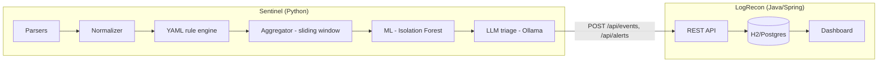

# Mini-SIEM: Sentinel + LogRecon

This project is split into two separate systems that communicate through a REST API:

- **Sentinel** (Python): the brain. It reads raw logs, understands what is happening and decides what counts as an alert.
- **LogRecon** (Java + Spring Boot): the body. It receives what Sentinel decided, stores it in a database, exposes an API and shows it on a dashboard.

Neither one duplicates the other's work. Sentinel never persists anything permanently and never serves an API to third parties; LogRecon never parses logs and never decides on its own what an alert is.

---

## Table of contents

- [What Sentinel does](#what-sentinel-does)
- [Sentinel progress](#sentinel-progress)
- [What LogRecon is for](#what-logrecon-is-for)
- [LogRecon progress](#logrecon-progress)
- [How the two connect](#how-the-two-connect)

---

## What Sentinel does

Sentinel reads the raw log (for now, the SSH `auth.log`) and decides, based on rules and later on models, whether what it sees is normal or a security alert:

1. **Parser**: reads the raw log line and extracts the fields (user, IP, event type, timestamp).
2. **Normalizer**: turns that into a standardized, typed format, independent of the original source.
3. **Rule engine**: compares the normalized event against YAML rules mapped to MITRE ATT&CK tactics (e.g. "5 failed logins from the same IP in 2 minutes" → Credential Access).
4. **Aggregator**: groups related events in a time window (sliding window), for rules that depend on repetition rather than on a single event.
5. **ML layer** (Isolation Forest): detects anomalies that fixed rules do not cover.
6. **LLM triage** (local Ollama, for privacy): gives a more "human" second opinion on what the previous steps flagged, before it becomes a real alert.
7. At the end, whatever survives the whole pipeline is sent to LogRecon through the REST API.

## Sentinel progress

- [x] **Phase 1: Log parsers** (`auth_parser.py`, abstract `BaseParser` class, YAML patterns)
- [x] **Phase 2: Normalizer** (`normalizer.py`, typed `Event` dataclass, `EventType` Enum, validation via `EXPECTED_FIELDS`)
- [x] **Phase 3: Rule-based detection engine** (`RuleLoader`, `EngineRule`, 16 YAML rules validated across 4 MITRE ATT&CK categories)
- [x] **Phase 4: Aggregator (sliding window)**: `LoginFailureAggregator` working; integration through an `EventProcessor` that orchestrates `EngineRule` + aggregator is in progress
- [x] **Phase 5: ML layer (Isolation Forest)**: intentionally paused until the rule engine/aggregator stabilize
- [ ] **Phase 6: LLM triage (local Ollama)**
- [ ] **Phase 7: MITRE ATT&CK mapping/enrichment** (full catalog, not only what is already embedded in the rules)
- [ ] **Phase 8: Alert/report manager + LogRecon API integration** (send events/alerts via `POST /api/events` and `POST /api/alerts`)

---

## What LogRecon is for

LogRecon **does not decide what an alert is**; that responsibility belongs to Sentinel alone. Its role is to:

- Expose a **REST API** that receives events and alerts that have already been processed.
- **Persist** everything in a structured way (sources, events, rules, alerts, MITRE tactics).
- Serve a web **dashboard** to see what is happening, without touching the database or a Python script.

## LogRecon progress

- [x] **Step 0: Scope and decisions**: a single log to start with (SSH `auth.log`), in-memory H2 database
- [x] **Step 1: Spring Boot project setup**
- [x] **Step 2: JPA entity modeling**, with a dedicated test for each one:
    - [x] `LogSource`
    - [x] `LogEvent`
    - [x] `MitreTactic`
    - [x] `DetectionRule`
    - [x] `Alert`
    - [x] `AlertEvent` (N:N join between `Alert` and `LogEvent`)
- [x] **Step 3: Ingestion REST API**
    - [x] `POST /api/sources`: registers a `LogSource` (tested with curl)
    - [x] `POST /api/events`: receives an already-processed `LogEvent`, resolves the source by name (tested with curl)
    - [x] Query endpoints (`GET /api/events`, filters by severity/date)
- [x] **Step 4: Alerts REST API**
    - [x] `POST /api/alerts`: receives an alert already classified by Sentinel (creates or reuses a `DetectionRule` + links `LogEvent`s through `AlertEvent`)
    - [x] `GET /api/alerts`: lists/filters alerts, with pagination
- [ ] **Step 5: Service-to-service authentication** (simple API key between Sentinel and LogRecon)
- [ ] **Step 6: Dashboard** (plain HTML/CSS/JS consuming the API: table of recent events, counter by severity, chart of events per hour)
- [ ] **Step 7: GitHub polish** (the repository's own README, dashboard screenshots, sample log included)

---

## How the two connect

Data flow, in the order it happens:

1. Sentinel processes a log and finishes deciding the severity/classification of an event.
2. It sends `POST /api/events` to LogRecon, providing `sourceName` (the source must already exist, registered beforehand via `POST /api/sources`).
3. If Sentinel's rules/ML/LLM pipeline concludes that the event is an alert, it sends `POST /api/alerts`, referencing the rule that fired and the events involved.
4. LogRecon persists everything and serves both API queries (`GET`) and the dashboard view.

Authentication between the two services (LogRecon Step 5) is not implemented yet. For now, communication has no authentication and is meant for a local development environment only.

---